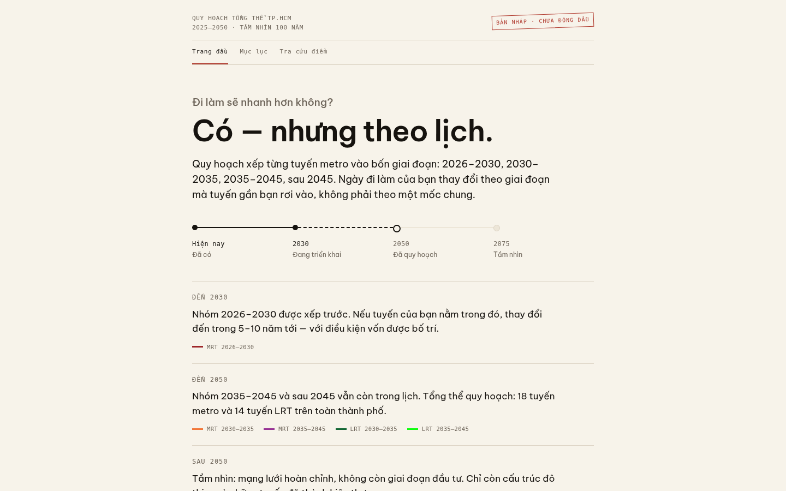
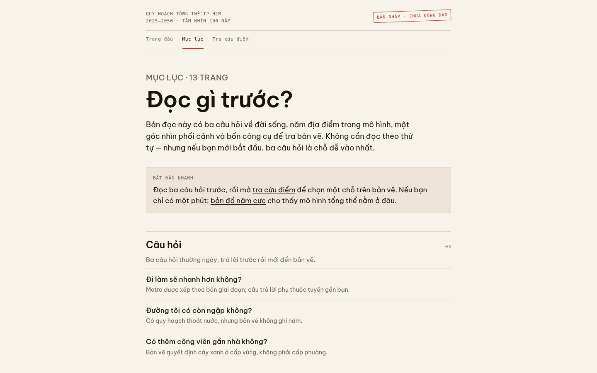
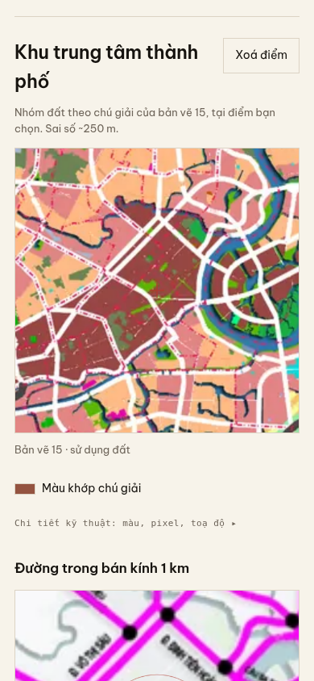
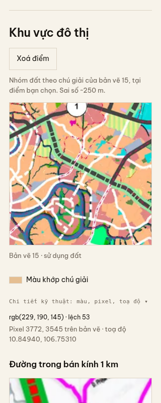

# UI/UX re-audit — after implementation

Date: 24/11/2026. Tested against `web/dist` at `http://127.0.0.1:4321`
(Python static server), rebuilt at 12:08 Asia/Saigon.

**Scope:** the fixes described in [UX-REVIEW.md](UX-REVIEW.md) were implemented,
then the whole site was re-audited: 15 built routes (13 content pages, `/muc-luc/`,
`/404.html`), desktop 1440×900, phone 390×844 with touch, 320 px reflow, keyboard,
tile failure, link crawl, and the full lookup flow.

---

## Verdict

The shell now explains the site. A first-time reader gets a persistent
`Trang đầu · Mục lục · Tra cứu điểm` nav on every page, a real 13-page index,
a question shown above every answer, one consistent question template, and a
lookup tool whose result is actually visible after the action.

All P0 and P1 issues from the baseline audit are closed. The remaining items are
deliberate limitations, not defects.

---

## What changed

| Baseline finding | Implementation | Verified |
|---|---|---|
| No navigation layer; first link on `/` at y = 2059 (83% down) | Sticky-in-flow header nav (no JS), skip link, `/muc-luc/` index, shared `Đọc tiếp` block from `src/data/site.ts` | Header links begin at **y ≈ 26**, and the nav row is above the fold on every page; 3 nav links on all 15 routes; home links `/tra-cuu/` twice (nav + CTA) |
| Home did not link the lookup tool | `Tra cứu điểm` in the header nav + CTA on all 3 question pages | 2 links to `/tra-cuu/` on each question page (nav + CTA) |
| `/can-gio/` had no home link | Global nav + shared ReadNext | Every page now has `Trang đầu` in the header |
| Question pages used two different templates; `/cay-xanh/` never showed its question | All three now use `p.q` (question) + `h1.answer`; question added to `/cay-xanh/` | Body text on `/cay-xanh/` contains the question; one `h1` per page on all routes |
| Lookup result was below the fold and unannounced | Result scrolls into view on first result; `role="status"` + `aria-live`; URL state; clear control; map hint; five sample points; technical detail disclosure | Result top = **20 px** after sample click/map tap on 390 px; URL `?lat=…&lon=…`; status text present; clear returns focus to “Bến Thành”; reload restores the result |
| Disabled address form was a fake door | Removed on all question pages and replaced with `AddressCta` | `input`/`form` count = **0** on all 15 routes |
| `/ban-do/` Tân Sơn Nhất and Vũng Tàu were unlinked and called unfinished | All five rows linked; marker popups link all five; `title`/`alt` per marker | 5 linked list rows; 5 distinct marker names; TSN popup reads “Xem trang địa điểm →” |
| Five markers were named “Marker” | `L.marker(..., { title, alt })` | Screen-reader names are the place names |
| `/can-chinh/` overflowed at 320 px | `.table-wrap` horizontal scroll; buttons 44 px | `scrollWidth 320` on all 15 routes, including the lookup result |
| Internal technical readout (`rgb`, `lệch`, pixel) in the primary result | Moved into `
 Chi tiết kỹ thuật`; visible line is the land class and match status | Visible result shows category + “Màu khớp chú giải”; `rgb`/pixel only when expanded |
| Plate text unreadable on phones; no enlargement | Every `figure img` gets a real `Mở ảnh đầy đủ` link + `Xem lớn ↗` hint (progressive enhancement) | 18 plate links; all 18 assets return 200; works without changing the figure markup |
| No 404 page, no favicon, no social metadata | `/404.html`, `/favicon.svg`, OG/Twitter/theme-color tags | `/404.html` 200; icon and OG tags present on every page |
| Map failure left a blank box | `tileerror` listener shows a message on both map pages | With OSM aborted, message visible: “Không tải được bản đồ nền…” |

---

## Re-audit results

### Navigation and wayfinding

- **15/15 routes** return 200; **0 console errors**, 0 page errors.
- The site nav is present on every route, with 3 links; `aria-current="page"` appears
  on `/`, `/muc-luc/` and `/tra-cuu/` as appropriate.
- The skip link is the first `Tab` stop, is visibly focused (44 px), and moves
  focus to `<main id="main">` (`#main`) as expected.
- The index lists **13 content pages** in four labelled groups
  (Câu hỏi 03, Địa điểm 05, Góc nhìn 01, Công cụ 04).
- The shared ReadNext block appears on every page except the index, uses 44 px
  rows, and is one column at ≤620 px.
- `/can-gio/` now has a home link; every page has one.
- The link crawl found **32 internal links, 19 images, 18 plate links** and
  **0 broken targets**.

### Lookup

- Five sample buttons (Bến Thành, Thủ Đức, Tân Sơn Nhất, Vũng Tàu, Cần Giờ)
  provide a keyboard/touch path that does not depend on hitting the map.
- After a sample or a map tap, the result is scrolled to the top (y = 20) and
  the map hint disappears; the `Xoá điểm` control appears.
- `history.replaceState` writes `?lat=…&lon=…`; opening that URL restores the
  result and the clear state. The coordinate is also surfaced in the technical
  details.
- The status region announces the category and note; `Xoá điểm` announces
  “Đã xoá điểm.”, clears the URL, removes the marker/circle, and returns focus to
  the first sample button (in view).
- The visible result is now: category → note with ~250 m error → crop → match
  status → road section → drainage section. The old road/drainage order mismatch
  with the intro is fixed.
- At 320 px the result, crops, sample row, and clear button do not overflow.

### Map page

- Five markers, five linked rows, five distinct accessible names, and popups
  that link to the finished place pages.
- With tiles blocked, a status message explains that the base map failed and that
  the list is the fallback.
- The map has a region role and an accessible name on both map pages.

### Accessibility and responsive checks

- Every route: one `h1`, heading order valid, all images have `alt`, all links have
  an accessible name, `lang="vi"`.
- Primary controls (nav, ReadNext, CTA, samples, map list, clear, calibration
  buttons, index rows) are ≥44 px high. Remaining small targets are inline prose
  links and Leaflet’s own attribution link.
- `:focus-visible` is a 2 px seal outline; the skip link works.
- 320 px: **0 horizontal overflow** on all 15 routes, including the lookup result.
- 390 px: **0 horizontal overflow**; ReadNext and index stack correctly.
- Contrasts are unchanged from the design system: ink 16.7:1, mute 5.16:1,
  seal 5.43:1 on paper.
- 18 plate links point at the full-size WebP and open in a new tab.

---

## Deliberate limitations (not regressions)

1. **Arbitrary point selection is still pointer/touch-only.** Five sample points
   are the keyboard fallback; the map help text states this. A coordinate or
   landmark picker would be the next step.
2. **`/can-chinh/` is still exposed.** It is labelled “(kỹ thuật)” in the index and
   footer, and its lede says it is not needed for reading. If the site becomes
   fully public, decide whether to hide it behind a direct URL.
3. **404 handling is host-dependent.** `404.html` is built; the local Python
   preview still returns its own raw 404 for unknown paths. A static host with
   `404.html` support will serve the page.
4. **OpenStreetMap is still a runtime dependency.** The failure is now explained,
   but there is no offline base map.
5. **No address geocoder.** The CTA explains the limitation and routes to the
   point sampler instead of pretending to accept an address.
6. **Plate zoom opens the full image in a new tab**, not an in-page lightbox. It
   is progressive enhancement; the plate is still readable without JS.
7. **Section pages have no active nav underline.** `aria-current` is only on the
   three items that exist in the nav; the kicker (`ĐỊA ĐIỂM · 01`, etc.) and the
   index carry the section context.
8. **The question line stays 19 px / 17 px.** It is a kicker above the 54/34 px
   answer, consistent with the editorial hierarchy; it can be raised if the
   question should dominate instead.

---

## Evidence

Before shots and the baseline measurements are in
[UX-REVIEW.md](UX-REVIEW.md) and `screenshots/ux-test/` (before) /
`screenshots/ux-test/after/` (after).

---

## Files changed

| File | Change |
|---|---|
| `src/layouts/Base.astro` | masthead link home, persistent nav, skip link, ReadNext, favicon/OG, plate zoom |
| `src/components/ReadNext.astro` | shared 44 px “Đọc tiếp” navigation derived from the page index |
| `src/components/AddressCta.astro` | replaces the disabled form with a lookup CTA |
| `src/data/site.ts` | single source of truth for sections, labels, blurbs |
| `src/pages/muc-luc.astro` | new 13-page index |
| `src/pages/404.astro` | new 404 page |
| `src/pages/index.astro`, `ngap.astro`, `cay-xanh.astro` | unified question template, question restored on Cây xanh, CTA, old link farm removed |
| `src/pages/thu-duc.astro`, `ben-thanh.astro`, `can-gio.astro`, `tan-son-nhat.astro`, `vung-tau.astro`, `my-khanh.astro`, `chu-giai.astro` | old link farm removed; shared nav takes over |
| `src/pages/tra-cuu.astro` | sample points, map hint, auto-scroll, status region, URL state, clear, technical disclosure, road/drainage order, tile fallback |
| `src/pages/ban-do.astro` | all five place links, marker names, tile fallback, corrected copy |
| `src/pages/can-chinh.astro` | 320 px table wrapper, technical-tool note |
| `src/styles/global.css` | nav, skip link, focus-visible, ReadNext, index, CTA, lookup result, map fallback, plate zoom, 320 px rules |
| `public/favicon.svg` | favicon |
| `README.md` | routes, nav, address fallback, file list |

Build: `pnpm build` — 15 pages, no errors. Re-audit script: no failing checks.
