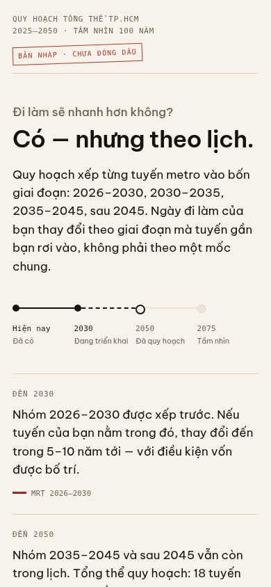
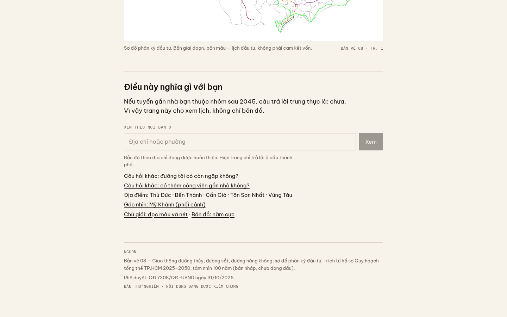
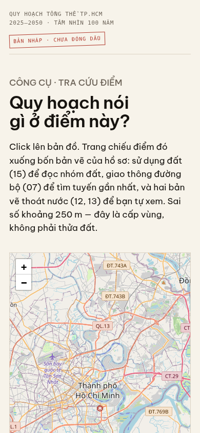
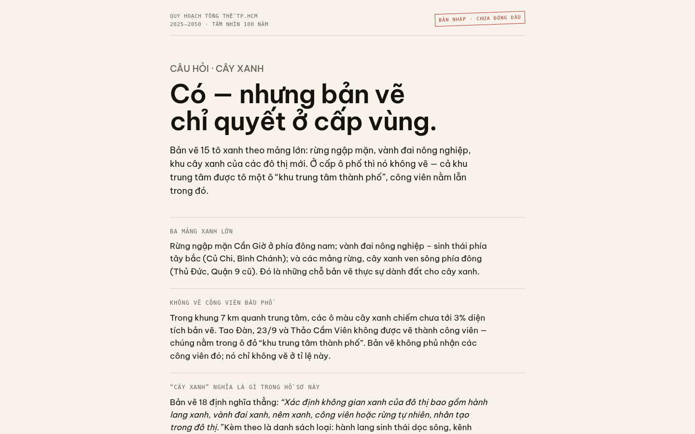
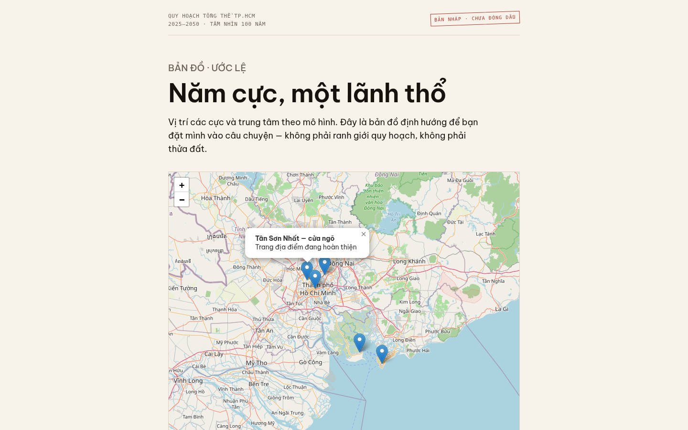
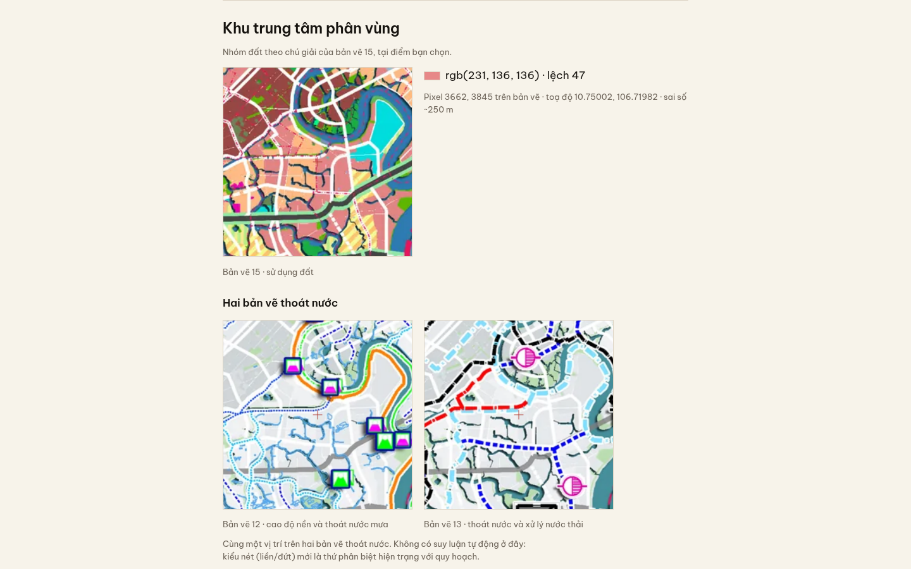

# Manual UI/UX test — saigon-2050 (baseline)

> **Status:** this is the baseline audit, recorded before the implementation pass. It is kept
> for comparison. The current state, the fixes and the post-implementation re-audit are in
> [UX-REVIEW-AFTER.md](UX-REVIEW-AFTER.md).

Tested on 24/11/2026 against the built site at `http://127.0.0.1:4321`
(`web/dist`, Python static server). 13 routes, desktop 1440×900, phone
390×844 (touch), and a 320 px reflow check. I walked the pages in reading
order, used the lookup tool, tabbed through, opened map popups, disabled
network tiles, and inspected the rendered DOM (headings, labels, target
sizes, contrast).

The site is **editorially strong and not yet self-explanatory**. The writing,
the answer-first layout and the honesty about what the drawings do not decide
are the best parts. The problems are almost all in the shell around that
content: navigation, feedback after an action, and consistency between the
three question pages.

---

## Verdict in one line

A beautiful reading experience that behaves like a set of unlisted print
sheets: once you are on a page it is clear, but finding your way in, across,
or back is left to the reader.

---

## What works

- **Answer first, evidence second.** Every question page states its answer
  before the plate, and the answer is written in plain Vietnamese.
- **The time strip is the site's best idea.** It carries the source's own
  vocabulary (years on `/`, unnamed rounds on `/ngap/`) and is correctly left
  out where the drawing has no schedule. This is genuinely useful, not decoration.
- **Honesty is designed in:** the `BẢN NHÁP · CHƯA ĐÓNG DẤU` stamp, the
  mandatory **“Điều bản vẽ không quyết định”** block, the ước lệ labels on
  both maps, and the refusal to read the drainage sheets all read as confidence
  rather than hedging.
- **The visual system holds.** Paper/ink palette, hairlines, mono kickers,
  the rotated stamp, radius 0, no shadows. Mobile line length and body type
  are comfortable.
- **Accessibility basics are present:** `lang="vi"`, one `h1` per page,
  logical `h2`s, descriptive `alt` on every image, 5.16:1 muted-text contrast
  and 5.43:1 stamp contrast on paper, no horizontal overflow on content pages
  down to 320 px.
- **Source plates are real evidence**, not generic stock imagery, and each
  is captioned with its sheet number and a caveat.

---

## Issues, ranked

### P0 — There is no navigation layer

No page has a header link, a nav landmark, a breadcrumb, or a site-map entry
point. The only way to reach another page is the flat link block at the very
bottom of the article.

| Evidence | Measurement |
|---|---|
| `<nav>` elements in the 13 built pages | **0** |
| Links in the first 900 px of `/` | **0** |
| First link on `/` at 1440×900 | **y = 2059** (page is 2471 px tall; 83% down) |
| First link on a 390×844 phone | **after ~2.4 screens** |
| First link on `/chu-giai/` | **y = 3216** (page 3616 px; 89% down) |
| `/can-gio/` link back to `/` | **missing** |
| Clickable site title / kicker | **no** |
| Pages with the address form | 2 of 3 question pages |

The home page also has **no link to `/tra-cuu/`** — the flagship interactive
tool is reachable only from `/ngap/`, `/cay-xanh/`, `/chu-giai/` and `/ban-do/`.
That is the single biggest discoverability gap on the site.

For keyboard users the problem is sharper: the first `Tab` on `/` lands on
the address input at y≈1949, jumping over the entire article, then continues
through the footer links. There is no skip link and no nav landmark.

**Fix:** a thin persistent nav under the header — *Câu hỏi · Địa điểm ·
Công cụ · Bản đồ* — with the header text linking home, plus a breadcrumb on
detail pages (`Địa điểm / Thủ Đức`). Keep the paper/type aesthetic; this does
not need to be a heavy global bar. The current “next” block should become a
categorised module with three labelled groups rather than one run-on paragraph.

---

### P0 — The lookup tool gives no visible result after you use it

`/tra-cuu/` is the most useful thing on the site, and its primary action looks
like a no-op.

On a 390×844 phone, tapping the map:

- draws a small red marker and a faint 250 m circle on the map (easy to miss);
- inserts results whose top is at **y = 1155**, below the **844 px** viewport;
- leaves `scrollY` at **0**;
- does not update the URL;
- adds no `aria-live`, no focus move, no toast, no “xem kết quả bên dưới” cue.

On desktop 1440×900 the result top is **y = 1148**, also below the fold.
So on both form factors the user taps, sees almost nothing, and concludes the
tool is broken unless they happen to scroll.

**Fix (high value, small diff):**

1. On first result, scroll the result into view **or** place the readout in a
   sticky panel above/next to the map;
2. `aria-live="polite"` on the result and move focus to its heading so screen
   readers hear it;
3. reflect the point in the URL (`?lat=…&lon=…`) so the answer is shareable and
   survives refresh — the code already parses those params on load, it just
   never writes them;
4. add a visible “xoá điểm / tra cứu điểm khác” control;
5. put a short instruction **on** the map (“Chạm vào bản đồ để tra cứu”) instead
   of only above it.

---

### P1 — The three question pages do not share an anatomy, and one never shows its question

`/` and `/ngap/` render the **question as a small grey `h1`** (19 px desktop,
17 px phone) with the **answer as a 54 px `
`**. `/cay-xanh/` does the
opposite: a category kicker (`CÂU HỎI · CÂY XANH`) + a 54 px answer `h1`, and
**the question is never shown in the body** — it exists only in the browser
tab title.

A reader who lands on `/cay-xanh/` from a search result sees:

> Có — nhưng bản vẽ chỉ quyết ở cấp vùng.

…with no visible “yes to what?”. The “Có” is doing work it cannot do without
the question.

The page furniture also differs: `/` and `/ngap/` carry the disabled address
form; `/cay-xanh/` does not. The same content type should not have two
different headers and two different action sets.

**Fix:** pick one question template and use it on all three. The cleanest
version is the one `/cay-xanh/` already uses visually — a readable kicker with
**the full question**, then the answer as the `h1` — but add the missing
question text to `/cay-xanh/`. Make the address-form policy identical across
all three (I would remove it, see next).

---

### P1 — The address form is a dead control

On `/` and `/ngap/`:

- the input is **enabled** and invites typing;
- the submit button is **disabled** (`opacity: .4`, `cursor: not-allowed`);
- pressing Enter does nothing (`onsubmit="return false"`);
- the explanation sits *below* the control, and only `/ngap/` points to
  `/tra-cuu/`; the home-page helper just says the map is being finished.

A disabled button under a live input is a well-known fake door: it reads as a
broken feature rather than an unfinished one. The honest fix is to stop
inviting input.

**Fix:** replace the form with a small CTA — “Tra cứu một điểm trên bản vẽ →”
linking to `/tra-cuu/`, or a disabled field with the helper inline and an
explicit “chưa hỗ trợ địa chỉ”. On the home page, at minimum link the tool.

---

### P1 — `/ban-do/` contradicts the rest of the site

Tân Sơn Nhất and Vũng Tàu both have finished place pages, but on the map page:

- their markers get `href: null` and a popup reading **“Trang địa điểm đang
  hoàn thiện”**;
- their rows in the list are plain text, with no link, while the other three
  rows link;
- all five marker icons have `alt="Marker"`, so keyboard and screen-reader
  users hear five indistinguishable “Marker” buttons (Leaflet markers are
  focusable, but they need names).

**Fix:** add the two hrefs and update the copy; give each marker a real
`title`/`alt`; use the list as the accessible fallback with all five linked.
This is a 10-minute content fix with a visible payoff.

---

### P2 — Evidence plates cannot be enlarged

The A0 evidence is the point of the site, but on a phone the plates are
displayed at ~354 px wide (the `/chu-giai/` legend crop goes from 736 px to
354 px; the phase diagram’s internal labels are unreadable). There is no
click-to-zoom, no full-resolution link, no `<dialog>` viewer.

**Fix:** wrap plates in a link to the full-size image or add a lightweight
lightbox. At minimum do it for the two legend crops, where the text is the
content.

---

### P2 — Accessibility and interaction details

- **Target size:** every link in the “next” block is **23 px high** with 4 px
  gaps — just under the WCAG 2.2 minimum (24×24), and far under the 44 px
  touch recommendation. On a phone the place links are a row of small text.
- **Map accessibility:** `/tra-cuu/`’s map has `tabindex="0"` but **no role,
  no aria-label, and no keyboard way to choose a point** (arrows pan; there is
  no Enter action and no coordinate/landmark input). A keyboard user cannot use
  the tool at all. The five `/ban-do/` markers are focusable but named “Marker”.
- **Dynamic status:** the lookup result has **no `aria-live`**, so a screen
  reader gets no announcement when the answer appears.
- **Landmarks:** no `<nav>`, no skip link, and the only navigation is a `
`
  of links inside the article — screen-reader users cannot jump to “navigation”.
- **Focus:** the browser default 1 px ring is present but thin and easy to lose
  on the hairlines. A designed `:focus-visible` (2 px seal, offset 2) would fit
  the system.
- **320 px reflow:** `/can-chinh/` overflows horizontally (`scrollWidth 344`
  vs `320`); the `.calib-table` is 326 px wide. The content pages are clean.
- **404:** a missing URL returns the static server’s raw `Error response`
  page; there is no `404.html`. Deploy-dependent, but this is the current
  preview behaviour.
- **Map failure:** with OpenStreetMap tiles blocked, both map pages render a
  blank beige box with only “+ − Leaflet | © OpenStreetMap”. No error message,
  no fallback. At minimum say the base map could not load.
- **Touch wording:** “Click lên bản đồ” is used on touch devices; “Chạm” would
  be more natural in the mobile copy.

---

### P2 — The readout speaks developer, not reader

The first result is legible (“Khu trung tâm phân vùng”), but the metadata next
to it is not:

> `rgb(231, 136, 136) · lệch 47`
> `Pixel 3662, 3845 trên bản vẽ · toạ độ 10.75002, 106.71982 · sai số ~250 m`

“lệch 47” has no unit or meaning for a public reader, and raw RGB/pixel
coordinates are QA information. The ~250 m error is the useful part; the rest
belongs behind a “chi tiết kỹ thuật” disclosure.

Also, the intro promises land use → roads → drainage, but the rendered order is
land use → drainage → roads. Small, but it costs the reader a re-scan.

---

## Consistency / content nits

- Footer link sets vary from page to page; `/can-gio/` is the only page with no
  home link, and it also omits the commute question while including the other
  two. There is no “all pages” route.
- `/ban-do/` and `/chu-giai/` are called different things in links
  (“Bản đồ: năm cực” vs the h1 “Năm cực, một lãnh thổ”; “Chú giải: đọc màu và
  nét” vs “Màu và nét nói gì?”). Not fatal, but the link text should match the
  destination heading where possible.
- `Hiệu chỉnh` (the internal calibration tool) is exposed in `/tra-cuu/`’s
  footer without any indication that it is a lab tool.
- The site has no favicon (`data:,`), so the tab looks unfinished; no OG image
  or social title either.

I did **not** find a content-provenance bug in the place pages: the
“sơ đồ các trung tâm” crops on `/thu-duc/` and `/ben-thanh/` really do come
from sheet 22, which carries that key diagram at the top left. The `BẢN VẼ 22`
citations are correct.

---

## Suggested fix order

1. **Header nav + home link + link `/tra-cuu/` from `/`** — biggest
   discoverability return, small diff.
2. **Lookup feedback:** scroll/focus result, `aria-live`, write `?lat&lon`,
   clear action, in-map instruction.
3. **Unify the question template** and add the missing question to
   `/cay-xanh/`.
4. **Fix `/ban-do/`:** link Tân Sơn Nhất and Vũng Tàu, update copy, name the
   markers.
5. **Replace the dead address form** with a CTA to `/tra-cuu/`.
6. **A11y pass:** 44 px targets in the next block, nav landmark/skip link,
   keyboard point picker (landmark list or coordinate input), 320 px table
   wrapper, 404 page, tile-failure message.
7. **Plate zoom** for mobile evidence reading.
8. **Move RGB/pixel/lệch into a `
` “chi tiết kỹ thuật”.**

---

## Test log (appendix)

### Page metrics (desktop 1440×900)

| Route | h1 class / size | First internal link | Page height | Home link |
|---|---|---|---|---|
| `/` | `.q` 19 px | y 2059 | 2471 | — |
| `/ngap/` | `.q` 19 px | y 2605 | 3039 | yes |
| `/cay-xanh/` | `.answer` 54 px | y 3430 | 3878 | yes |
| `/thu-duc/` | `.answer` 54 px | y 2224 | 2637 | yes |
| `/ben-thanh/` | `.answer` 54 px | y 1516 | 1901 | yes |
| `/can-gio/` | `.answer` 54 px | y 2246 | 2631 | **no** |
| `/tan-son-nhat/` | `.answer` 54 px | y 2714 | 3121 | yes |
| `/vung-tau/` | `.answer` 54 px | y 2738 | 3124 | yes |
| `/my-khanh/` | `.answer` 54 px | y 1740 | 2119 | yes |
| `/chu-giai/` | `.answer` 54 px | y 3216 | 3616 | yes |
| `/tra-cuu/` | `.answer` 54 px | y 1479 | 2002 | yes |
| `/ban-do/` | `.answer` 54 px | y 1006 | 1793 | yes |
| `/can-chinh/` | `.answer` 54 px | y 1392 | 1695 | yes |

“First internal link” includes in-article links (e.g. the Leaflet attribution
is excluded); on every page it is still below the main reading content and
there are zero header/nav links.

### Checks run

- 13 routes, 200s; titles and descriptions present; one `h1` each.
- 1440×900 and 390×844 full-page and viewport screenshots.
- 320 px overflow check on 8 routes; only `/can-chinh/` fails.
- Keyboard: `Tab` order on `/`, `/ban-do/`; focus ring computed style.
- Lookup: map click/tap, result position, scroll position, URL, marker/circle,
  `aria-live`, map ARIA attributes.
- `/ban-do/`: marker click, popup text, marker accessible names, tab order.
- Image load: all `alt`s present; two images initially reported `naturalWidth 0`
  were lazy-loaded below the fold and loaded correctly on scroll (not a bug).
- Contrast: ink 16.7:1, mute 5.16:1, seal 5.43:1 on paper.
- Tile-blocked run: both maps blank with no fallback message.
- 404: raw server error; no `404.html`.
- Plate provenance: rendered sheets 01/05/06/22 at low dpi to verify the
  “BẢN VẼ 22” citations on the place pages — correct.
